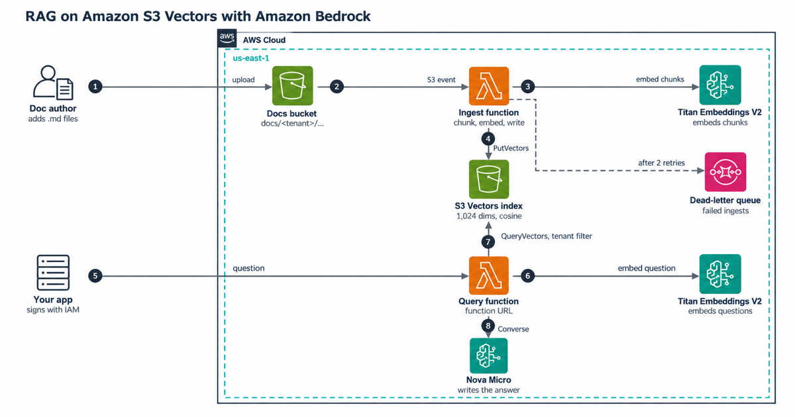

# RAG on Amazon S3 Vectors

Retrieval-augmented generation (RAG) with Amazon S3 Vectors as the vector store and Amazon Bedrock for embeddings and answers. You drop a Markdown or text file into an S3 bucket, and a few seconds later you can ask questions about it. The retrieval layer costs cents a month at 100,000 chunks, and there's no cluster to keep running.

Everything is AWS Cloud Development Kit (CDK) v2 in TypeScript, tested without an AWS account.

## Architecture



## How it works

```text
docs/<tenant>/<category>/<doc>.md  ->  S3 event  ->  Ingest Lambda
                                                     chunk -> Titan Text Embeddings V2 -> PutVectors
                                                                                            |
                                                                              S3 vector index "chunks"
                                                                                            |
POST {tenant, question}  ->  Query Lambda (function URL, IAM auth)                          |
                             embed question -> QueryVectors (tenant filter) ----------------+
                             drop far matches -> Bedrock Converse (Amazon Nova Micro) -> answer + sources
```

- **Ingest.** The function splits each document into chunks of up to 1,200 characters, keeping paragraphs whole when they fit and repeating the last sentence or two of each chunk at the start of the next. Amazon Titan Text Embeddings V2 turns each chunk into a normalized 1,024-dimension vector, and the function writes them with `PutVectors` in batches of 500. A re-upload overwrites chunks in place and deletes the ones a shorter version no longer has. Deleting the file deletes its vectors. S3 doesn't deliver events in order, so the function ignores the event type and checks the object itself: if it exists, it gets indexed, and if it's gone, its vectors go too. Two uploads of one file can be indexed at the same time, and the older one can finish last. So after each write the function checks the object's ETag again and re-indexes if the file changed in the meantime.
- **Query.** The function embeds the question, searches the index with a metadata filter that includes the caller's tenant on every query, and drops matches with a cosine distance above 0.6. If nothing is left, it answers "not found" without calling the model. Otherwise it sends the chunks to Nova Micro through the Converse API and returns the answer with its sources.
- **Metadata.** `tenant`, `category`, `doc` and `updated` are filterable. The chunk `text` and its heading (`title`) are non-filterable: a chunk is far bigger than the 2 KB filterable allowance, and non-filterable metadata isn't counted in query processing charges.

## What it costs

These are us-east-1 prices from the AWS Price List API, checked on 2026-10-16. `npm run cost` prints this table, and `docs/cost.md` shows the math:

| Chunks | Questions a month | S3 Vectors (storage + queries) | Answers (Nova Micro) | Monthly total | One-time embed + write |
|---|---|---|---|---|---|
| 100,000 | 100,000 | $0.43 | $8.75 | $9.23 | $0.84 |
| 100,000 | 1,000,000 | $4.07 | $87.50 | $91.97 | $0.84 |
| 10,000,000 in one index | 1,000,000 | $83.41 | $87.50 | $171.31 | $84.41 |
| 10,000,000 in 100 indexes | 1,000,000 | $7.13 | $87.50 | $95.03 | $84.41 |

At small scale, the model is almost the whole bill. At 10 million chunks, the per-query processing charge grows with the size of the index you search, so splitting by tenant matters. For comparison, an OpenSearch Serverless classic collection bills at least $350.40 a month for compute, and Aurora Serverless v2 held at 0.5 Aurora capacity units (ACU) bills $43.80. Lambda is not in the table. At 100,000 questions a month, it fits inside the monthly free tier of 1 million requests and 400,000 GB-seconds if each answer takes under 8 seconds at 512 MB.

## Try it on your laptop

You need Node.js 24 and npm. This part needs no AWS account:

```bash
npm ci
npm run check   # type check, lint, bundle, 148 tests, synth with cdk-nag
npm run cost    # the cost table above
```

The tests run the real Lambda handlers end to end. AWS calls go to in-memory fakes: an S3 vector index that ranks with the same cosine and euclidean math and enforces the documented limits, a hashed bag-of-words embedder, and a canned model reply.

## Deploy

You need a CDK-bootstrapped account, model access to Titan Text Embeddings V2 and Nova Micro in Amazon Bedrock, and a Region where both Bedrock models and S3 Vectors are available. The stack deploys to us-east-1 unless you set `CDK_DEFAULT_REGION`.

```bash
npm run deploy
aws s3 cp refunds.md s3://<DocsBucketName>/docs/acme/policies/refunds.md
npm run smoke   # uploads a test document, asks about it, checks tenant isolation, deletes it
```

Call the query URL with SigV4-signed requests (the function URL uses IAM auth). The body looks like this:

```json
{ "tenant": "acme", "question": "How long do refunds take?", "categories": ["policies"], "topK": 5 }
```

Options: `-c generationModelId=us.amazon.nova-lite-v1:0` picks another model or a cross-Region inference profile, and `-c ingestConcurrency=0` removes the cap of 2 concurrent ingest functions.

## Clean up

Run `npm run destroy`. The stack deletes the vector bucket and index, since you can rebuild them from the documents. The documents bucket is kept on purpose; empty and delete it in the S3 console when you're sure.

## More

| Doc | What's in it |
|---|---|
| [docs/cost.md](docs/cost.md) | Prices, the formula, and how to split indexes |
| [docs/limits.md](docs/limits.md) | The S3 Vectors limits this code relies on, quoted |
| [docs/security.md](docs/security.md) | Tenant isolation, IAM, prompt injection |
| [docs/runbook.md](docs/runbook.md) | Failed ingests, re-indexing, changing the model |
| [CONTRIBUTING.md](CONTRIBUTING.md) | Layout and what a change needs |

License: MIT-0. This project isn't affiliated with AWS.

---

Created by Rahul Ladumor / InfraTales
